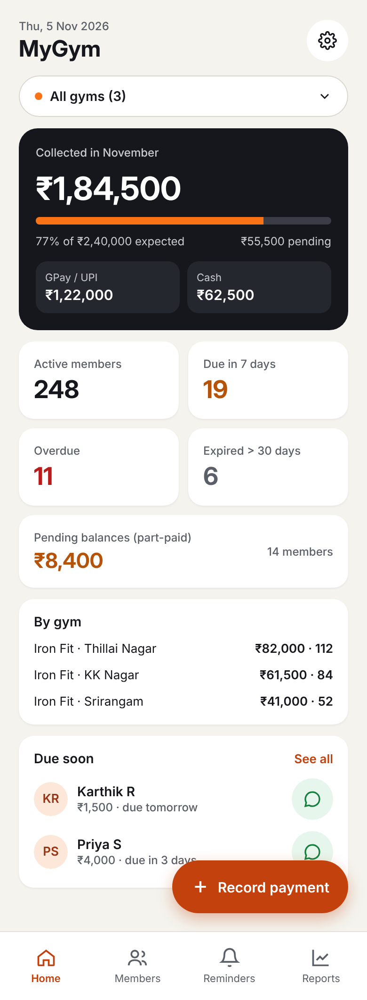
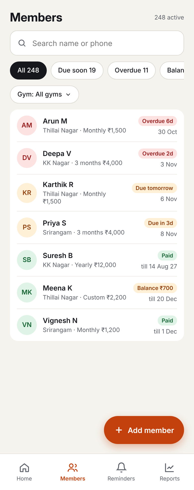
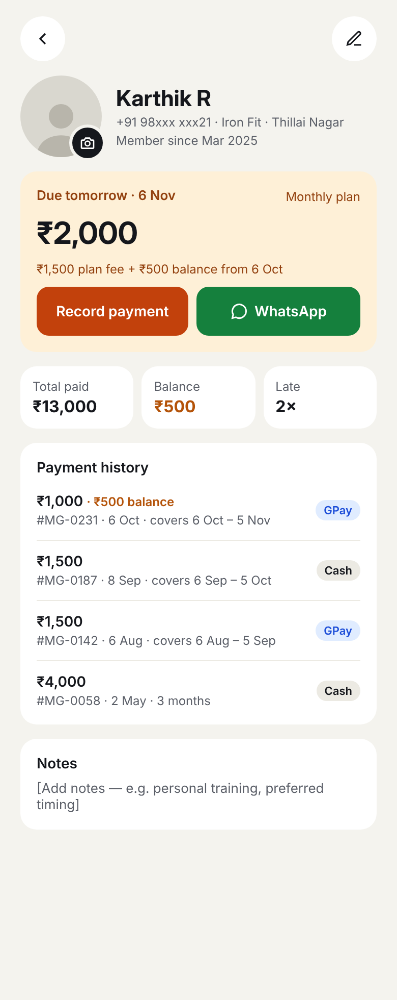
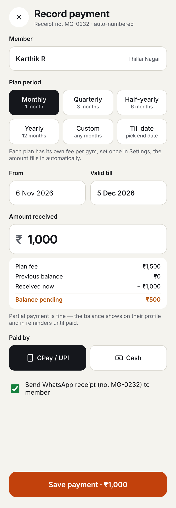
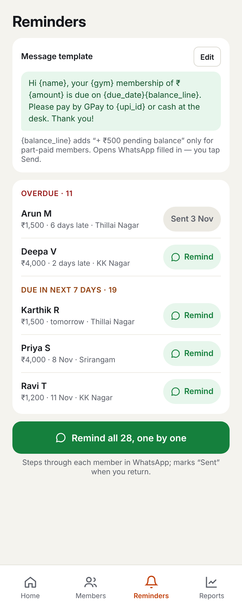
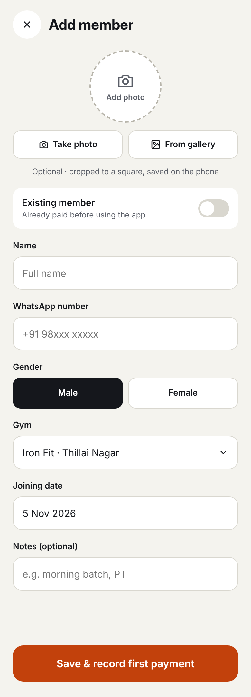
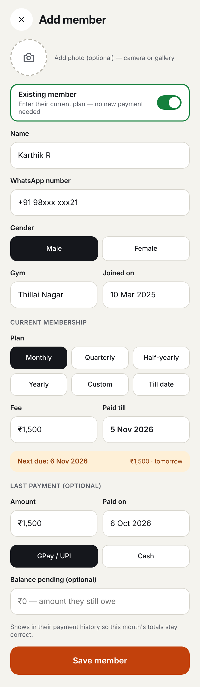
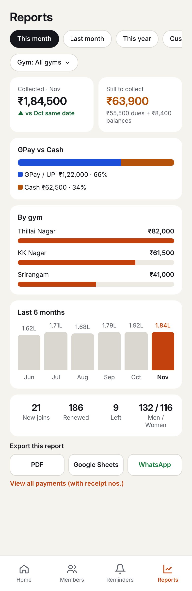
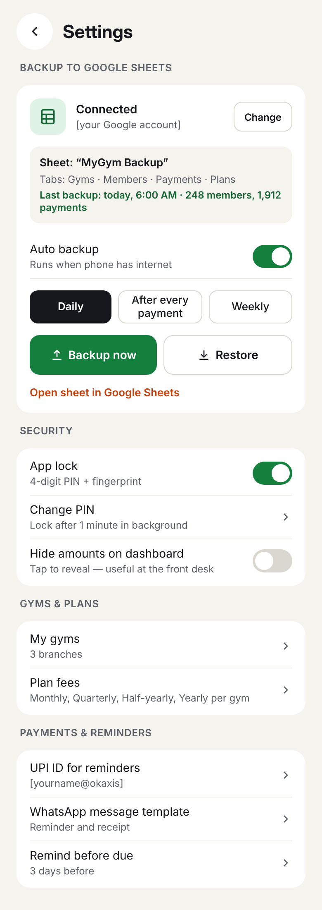
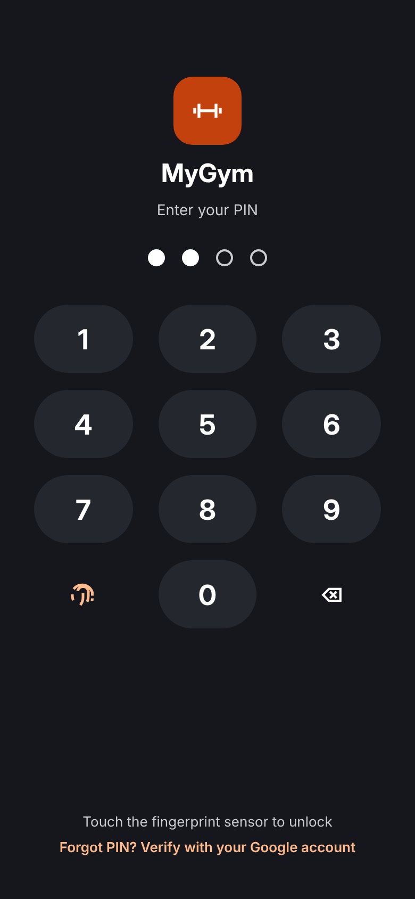

# MyGym

Android app to manage members and payments across multiple gyms: GPay/cash payments, due dates, pending balances, WhatsApp reminders, reports, Google Sheets backup and app lock.

Built with **React Native + Expo** (SDK 53, expo-router, expo-sqlite). All data is stored on the phone in SQLite.

## Screenshots

<table>
  <tr>
    <td align="center"><br><sub>Home</sub></td>
    <td align="center"><br><sub>Members</sub></td>
    <td align="center"><br><sub>Member detail</sub></td>
    <td align="center"><br><sub>Record payment</sub></td>
  </tr>
  <tr>
    <td align="center"><br><sub>WhatsApp reminders</sub></td>
    <td align="center"><br><sub>Add member</sub></td>
    <td align="center"><br><sub>Add existing member</sub></td>
    <td align="center"><br><sub>Reports</sub></td>
  </tr>
  <tr>
    <td align="center"><br><sub>Settings &amp; backup</sub></td>
    <td align="center"><br><sub>App lock</sub></td>
    <td></td>
    <td></td>
  </tr>
</table>

<sub>Screens from the MyGym app design; sample data only.</sub>

## What's in the app

| Screen | What it does |
|---|---|
| Home | Collected this month (GPay vs cash), active / due soon / overdue / expired counts, pending balances, totals by gym, due-soon list with WhatsApp button |
| Members | Search, filters (due soon, overdue, balance, paid, expired, men, women), gym filter |
| Member detail | Photo, next amount due (fee + balance), Record payment, WhatsApp reminder, collect balance only, payment history with receipt numbers, resend receipt, undo latest payment, mark as left |
| Add member | Photo (camera/gallery), name, WhatsApp number, gender, gym, joining date. **Existing member** switch: current plan, paid-till date, balance, optional last payment |
| Record payment | Monthly / Quarterly / Half-yearly / Yearly / Custom months / Till date, auto "valid till", fee from gym settings, partial payment → balance, GPay or cash, auto receipt no. (MG-0001…), WhatsApp receipt |
| Reminders | Overdue, due soon and part-paid lists, editable message, "Remind all one by one" |
| Reports | This month / last month / year / custom, by gym, GPay vs cash, 6-month trend, joins, renewals, men/women; export PDF, Google Sheets, WhatsApp summary |
| Settings | Google Sheets backup (daily / after every payment / weekly, backup now, restore), app lock (PIN + fingerprint), hide amounts, gyms & plan fees, UPI ID, receipt prefix, due-soon window, message templates |

WhatsApp works through `https://wa.me/<number>?text=…`: the chat opens with the message typed in and you tap **Send**. No WhatsApp API or cost.

## 1. Set up on your computer

You need Node.js 20+ and a free Expo account (https://expo.dev/signup).

```bash
git clone https://github.com/renuraj18/MyGym.git
cd MyGym
npm install
npx expo install --fix     # aligns every Expo package to the exact SDK version
npm install -g eas-cli
eas login
```

## 2. Build the APK (no Android Studio needed)

```bash
eas build -p android --profile preview
```

When the build finishes, EAS gives you a link. Open it on your phone, download the APK and install it (allow "install unknown apps" if Android asks).

> The app uses native modules (Google Sign-In, fingerprint, SQLite), so it does **not** run in Expo Go. For day-to-day development build a dev client once with `eas build -p android --profile development`, install it, then run `npx expo start --dev-client`.

## 3. Turn on Google Sheets backup (one-time, ~10 minutes)

The backup signs in with your Google account and writes a sheet called **MyGym Backup** in your Drive (tabs: Gyms, Members, Payments, Settings). The app only gets access to files it creates (`drive.file` scope).

1. Go to https://console.cloud.google.com, create a project (e.g. "MyGym").
2. **APIs & Services → Library**: enable **Google Sheets API** and **Google Drive API**.
3. **OAuth consent screen**: choose *External*, fill in the app name and your email, and add your Gmail under **Test users**.
4. Get the SHA-1 of your app's signing key: run `eas credentials` → Android → *preview* → copy the **SHA-1 fingerprint**.
5. **Credentials → Create credentials → OAuth client ID → Android**:
   - Package name: `com.renuraj.mygym`
   - SHA-1: the value from step 4
6. (Recommended) Also create an OAuth client of type **Web application** and put its client ID in `app.json`:
   ```json
   "extra": { "googleWebClientId": "1234-xxxx.apps.googleusercontent.com" }
   ```
7. Rebuild the APK, then in the app go to **Settings → Backup to Google Sheets → Connect**.

Restore (Settings → Restore) replaces the data on the phone with the sheet — use it on a new phone after connecting the same Google account. Member photos stay on the phone and are not copied to the sheet.

## First run

1. Add your gyms and their plan fees (Monthly / Quarterly / Half-yearly / Yearly).
2. Set your UPI ID in Settings (it goes into reminder messages).
3. Add members — use **Existing member** for people who already paid before you started using the app.
4. Optional: Settings → Security → App lock.

## Project layout

```
app/                 screens (expo-router)
  (tabs)/            Home, Members, Reminders, Reports
  member/[id].tsx    member detail      member/new.tsx  add / edit member
  payment/new.tsx    record payment
  settings.tsx gyms.tsx templates.tsx pin.tsx
src/db/              SQLite schema + all queries (repo.ts)
src/lib/             dates, money formatting, WhatsApp, photos, backup, lock
src/components/      shared UI + lock screen
```

Dates are stored as `YYYY-MM-DD`. A member's **paid till** date is the last day covered; the next due date is the day after. "Overdue" means past the due date; more than 30 days overdue counts as "expired".
